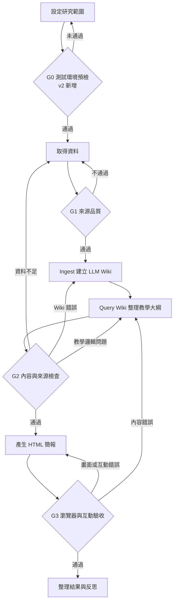

# AGENTS.md — 百萬 Token 長上下文 LLM Wiki

## 目標
從學術與公開技術資料建立可查詢的 Wiki，以 Wiki 作唯一的簡報知識整理入口，製作初學者可閱讀的 17 頁 HTML 教學簡報。研究不預先指定必選論文、技術或特定公司。

## Agent Loop / Graph

v1 沒有 G0；v2 將測試環境檢查提前至搜尋前，並加強 N1 摘錄即時核對、N2 建庫後的連結 Lint。Graph 是規則與回退設計，不代表每條分支在本次都實際發生；實際紀錄見 [logs/log.md](logs/log.md)。

## 查驗及內容規則

1. N1 選擇可靠來源，至少 5 份有實際攝取紀錄；須標明讀取深度及引用 ID。
2. N2 Wiki 主題頁需互相連結、整理共同概念；所有關鍵主張都能回查 [來源](wiki/sources.md)。
3. N3 先查 Wiki 才編排大綱；逐頁來源對照見 [索引](wiki/slide-map.md)。
4. G1/G2/G3 以證據判斷 PASS、FAIL 或 NOT_TESTED，失敗按根因回退。
5. HTML 為根目錄 [index.html](index.html)；此倉庫是成果存檔，**不包含完整的自動研究與測試腳本**。
6. 不得把檢索頁面／摘要當作已精讀全文，不得捏造來源、測試或修正歷史。
